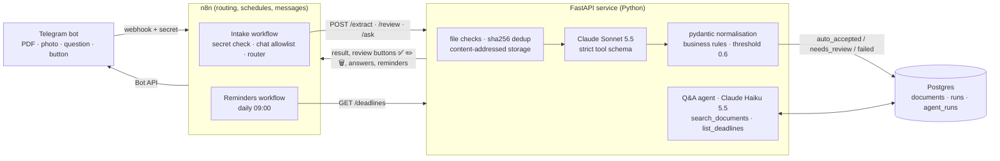

# DocFlow AI: incoming documents for a small office, automated with Claude and n8n

[](https://github.com/ValeriiKoval/docFlow/actions/workflows/ci.yml) [](LICENSE)

A small office or accounting firm receives invoices, utility bills, receipts, contracts and insurance policies as PDFs and phone photos. Someone has to retype each one into a register and remember every payment deadline and expiry date. **DocFlow AI** takes a document sent to a Telegram bot and does the rest:
- it extracts 11 fields with Claude;
- it validates them and stores them in Postgres;
- it asks a human to check only the documents it is unsure about;
- it reminds the team about deadlines;
- it answers questions such as *"When does the insurance expire?"* in plain language.

**Result on a held-out test set of 50 synthetic documents** (uk / pl / en, every document also as 3 levels of degraded scan):

| | Clean PDF | Light scan | Medium scan | Heavy scan |
|---|---|---|---|---|
| All 11 fields correct | **100%** | **100%** | **98%** | 60% |
| Auto-accepted at confidence ≥ 0.6 | 100% | 100% | 100% | 26% (the rest goes to a human) |

At the chosen threshold, 1 wrong document in 200 passes without review. Cost: **$0.012 per document**, 3–4 s. A Q&A answer costs **$0.0006**.

<!-- Demo: docs/img/demo.gif (Telegram: photo → review buttons → question → answer) -->


*Left, the clean PDF: extracted with confidence 0.97 and auto-accepted. Right, the same policy as a heavy scan: Claude misread the issue date (26 → 28) but reported confidence 0.5, so the document went to human review instead of into the register.*

## Contents

1. [Business context](#1-business-context)
2. [Architecture](#2-architecture)
3. [How it works](#3-how-it-works)
4. [Quality](#4-quality)
5. [Cost and performance](#5-cost-and-performance)
6. [Reliability](#6-reliability)
7. [Privacy](#7-privacy)
8. [Reusable components](#8-reusable-components)
9. [Effort estimate](#9-effort-estimate)
10. [Run it](#10-run-it)
11. [Limitations and next steps](#11-limitations-and-next-steps)

## 1. Business context

**Who it is for:** a small office, an accounting firm serving small clients, or a household that runs like one. They handle tens to hundreds of documents a month in several languages (here Ukrainian, Polish, English), and they have no ERP or a heavy one nobody wants to type into.

**What it saves:**
- **Data entry.** Typing 11 fields from a document takes a few minutes. Here a person sends a photo and gets a summary back in about 4 s. Clean PDFs need no human at all; poor scans need a check of pre-filled fields, not typing.
- **Missed deadlines.** Payment due dates and policy or contract expiries become reminders 7, 3 and 1 days ahead and on the day.
- **Searching.** *"How much do we owe Kappa IT and by when?"* is answered from the register with a reference to the document (`#12`) instead of digging through a shared folder.

**What it does not do:** it does not pay invoices or post to accounting. The register is the integration point for that (see [next steps](#11-limitations-and-next-steps)).

## 2. Architecture



**Component choices:**

| Choice | Why |
|---|---|
| **n8n for the edges, Python for the core** | n8n is good at what changes per client: channels (Telegram, email, Drive), schedules, message wording. Logic that must be tested lives in a FastAPI service with 53 pytest tests: validation, dedup, the review state machine, deadline queries, the agent. |
| **Webhook node + Bot API over HTTP** instead of n8n's Telegram nodes | Every setting comes from environment variables, so the workflows import and run with no clicking in the UI. The same workflows also run against a mock Bot API in an offline test ([n8n/test_workflow.py](n8n/test_workflow.py)). |
| **Structured output via a strict tool** (`record_document`) | The answer always parses into the schema: 0 invalid responses in 1,200 eval calls. The JSON schema doubles as documentation of every field. |
| **PDF and images sent to Claude directly** | No separate OCR stack. Claude reads text-layer PDFs, scans and photos with one code path. |
| **Model-reported confidence + business rules → human review** | The eval showed that confidence separates right from wrong extractions on poor scans (section 4). Rules catch what confidence misses, for example a due date before the issue date. |
| **Sonnet 5.5 for extraction, Haiku 5.5 for Q&A** | Each model was chosen by an eval. Haiku drops to 28% on heavy scans, but over already extracted data it answers 12 of 13 eval questions (Sonnet: 13) at 1/15 of the cost. |
| **Agent on the plain Messages API** | Questions are short and the tools are two SQL queries in the same service. A tool-use loop of ~100 lines is enough; a hosted agent platform would only add latency and cost. |
| **Postgres as the "CRM"** | A register with a REST API in front of it. Replacing it with Airtable, HubSpot or an ERP means changing one integration, not the pipeline. |

## 3. How it works

**Input:** the insurance policy above, sent to the bot as a PDF. It contains traps:
- the sum insured (€201,000) next to the premium (€3,308.44);
- an issue date that differs from the start of cover;
- dates written out as words.

**Claude's output** (strict tool call, [prompts/extract_v2.md](prompts/extract_v2.md), [schema.json](schema.json)):

```json
{
  "doc_type": "insurance",
  "language": "en",
  "counterparty": "Contoso Insurance plc",
  "recipient": "Jane Example",
  "document_number": "HC8143344",
  "issue_date": "2026-07-26",
  "currency": "EUR",
  "total_amount": 3308.44,
  "due_date": null,
  "valid_from": "2026-08-09",
  "valid_until": "2027-08-08",
  "confidence": 0.97
}
```

**What happens next:**
1. **Service checks.** The service normalises the fields and applies business rules: a validity period only on policies and contracts, `valid_until` not before `valid_from`, the currency an ISO code. Confidence 0.97 ≥ 0.6 and no rule is violated, so the status is `auto_accepted`.
2. **Bot reply.** The bot replies ✅ with a summary.
3. **Heavy scan.** The heavy scan of the same policy gets confidence 0.5, so it is marked `needs_review`. The bot shows the fields, the reason and three buttons:
   - **✅** approves the fields as they are;
   - **✏️** asks for corrections as `issue_date=2026-07-26`, which are validated again;
   - **🗑** rejects the document.

   Every decision is stored with the reviewer's name.
4. **Reminders.** On 2027-08-01 the reminders workflow sends a reminder to the chat the policy came from: the policy expires 2027-08-08, in 7 days, with its number, insurer and `#id`. The bot speaks English; the agent answers in the language of the question.
5. **Q&A.** For *"When does the Contoso policy expire?"* the agent looks the policy up with `search_documents` and answers with the date and `#id`.

The full API (endpoints, review flow, agent) is described in [service/README.md](service/README.md); the bot flows in [n8n/README.md](n8n/README.md).

## 4. Quality

**Method** (full write-up: [eval/RESULTS.md](eval/RESULTS.md)):
- **Data.** Two synthetic sets of 50 documents: 9 each of invoice, utility bill, receipt, contract and insurance, plus 5 `other`. They come from [a generator](eval/generate_dataset.py) with 4 layouts, localised labels, written-out dates, currency symbols and deliberate traps, such as net/VAT/gross amounts, fiscal numbers that look like document numbers, a monthly payment vs the contract value, and stamps.
- **Scans.** Each document is also rasterised and degraded at 3 levels: rotation, blur, noise, JPEG artefacts, shadow. That gives 200 extractions per set.
- **Two sets.** The **dev** set was used to read errors and rewrite the prompt. The **test** set (a different seed) was run only with the final prompts, so the numbers below are not tuned to it.
- **Metric.** A field is correct on an exact match after normalisation. A document is correct only if all 11 fields are.

**Results, test set** ([all tables](eval/results/summary_test.md)):

| Run | Clean | Light | Medium | Heavy | Cost / 1000 docs |
|---|---|---|---|---|---|
| Sonnet 5.5, prompt v1 | 92% | 90% | 90% | 54% | $10.3 |
| **Sonnet 5.5, prompt v2** | **100%** | **100%** | **98%** | **60%** | **$11.8** |
| Haiku 5.5, prompt v2 | 100% | 98% | 100% | 28% | $0.7 |

**Field accuracy, Sonnet v2, heavy scans** (all other levels are 100% except one document number on a medium scan):

| doc_type | language | counterparty | recipient | number | issue_date | currency | total | due_date | valid_from | valid_until |
|---|---|---|---|---|---|---|---|---|---|---|
| 100% | 100% | 94% | 92% | 86% | 76% | 98% | 84% | 96% | 96% | 100% |

**Typical errors and how they were fixed** (prompt v1 → v2, found on the dev set with [eval/errors.py](eval/errors.py)):

| Error in v1 | Fix in v2 |
|---|---|
| Insurance amount = sum insured instead of premium (9 of 9 policies) | `total_amount` defined per document type; insurance = premium, explicitly not the sum insured |
| Receipt number = fiscal number when the receipt has none of its own | List of numbers that are not document numbers (fiscal, terminal, account, tax ID, IBAN) |
| Confidence ≥ 0.8 on wrong documents | Confidence = probability that every field is right, judged by the weakest field, with explicit bands |

The one remaining error on clean to medium documents: a document number printed with Cyrillic letters came back with the look-alike Latin letters. Heavy-scan errors are mostly misread digits on blurred images. That is what the review step is for.

**Q&A agent:** 13 questions generated from the test labels ([eval/qa_eval.py](eval/qa_eval.py)):
- exact facts in Polish and English;
- lists of upcoming deadlines (every expected document must be cited);
- a count;
- a question about a company that is not in the register, which must not get an invented answer.

Sonnet 5.5 passes **13/13**, Haiku 5.5 **12/13**: for the company that is not in the register it hit the turn limit and gave the fallback reply instead of a clear "not found", without inventing a date ([answers](eval/results/qa_claude-haiku-5-5.md)).

## 5. Cost and performance

| | Model | Cost | Latency |
|---|---|---|---|
| Extract one document | Sonnet 5.5 | $0.012 (≈4,000 input + 370 output tokens) | 2.9–3.8 s in the eval, 4.2 s end to end through Telegram |
| Answer one question | Haiku 5.5 | $0.0006 | ~3.7 s |
| Running the eval (1,203 calls) | both | ~$9 total | |

For an office with **1,000 documents and 1,000 questions a month**, the Claude bill is about **$13 a month**. Hosting (Postgres, API and n8n on one small VPS) is extra.

**Effect of the confidence threshold** (Sonnet v2, test set, heavy scans; each cell: auto-accepted / accuracy of the accepted / wrong documents that slipped through):

| Threshold | 0.5 | **0.6** | 0.7 | 0.8 |
|---|---|---|---|---|
| Heavy scans | 56% / 86% / 4 | **26% / 100% / 0** | 12% / 100% / 0 | 4% / 100% / 0 |

On clean to medium documents every threshold up to 0.8 auto-accepts 100%. **0.6** is the lowest threshold that lets no wrong heavy scan through. Across all 200 test extractions:
- 81.5% are accepted automatically;
- 18.5% go to a human;
- 1 error passes.

Every Claude call is logged in the `runs` and `agent_runs` tables (tokens, cost, latency, attempts, errors). `GET /stats` sums them up.

## 6. Reliability

- **Input checks.** The file type is detected from magic bytes, not from the name. There are size and page limits, and unreadable PDFs are rejected with a clear message.
- **Structured output.** The response is validated against the full JSON schema. If Claude returns no valid tool call, the request is retried up to 3 times. For refusals, the call falls back server-side to another model.
- **Normalisation and rules.** pydantic normalises whitespace, number labels (`№`, `nr`), currencies and amounts like `1 234,56`. Business rules send a document to review even when confidence is high.
- **Human in the loop.** Review happens in Telegram with buttons. Corrections are re-validated, and the decision is stored with the reviewer's name.
- **Dedup.** Documents are deduplicated by sha256. A repeated document is answered from the database with no new Claude call. A previously failed one is processed again.
- **Failures.**
  - An API or schema error marks the document `failed`; the bot offers to enter the fields manually or to reject it, and `/reprocess` retries.
  - If the agent fails, the user gets a polite fallback answer.
  - Tool errors go back to Claude as `is_error`, so it can correct its call.
- **Security.**
  - The Telegram webhook secret is checked in the second node.
  - Only allow-listed chats are served.
  - The API and the manual reminders webhook require an API key.
  - The API container runs as a non-root user.
  - Secrets live only in `.env`, which is git-ignored.
- **Tests.**
  - 53 pytest tests with fake Claude clients.
  - An offline end-to-end test of both n8n workflows against a mock Telegram Bot API, which covers: wrong secret, help, auto-accept, review with correction and approval, question, `/deadlines`, access denied, and reminders.

## 7. Privacy

All documents in this repository are **synthetic**. The companies and people are fictitious (`Contoso Insurance plc`, `Jane Example`, `Kappa IT`), and IBANs, tax IDs and fiscal numbers are random, in a realistic format. Each page carries the footer "Synthetic test document". The generator models what makes real documents hard:
- localised labels and written-out dates in three languages;
- several amounts on one page;
- numbers that look like the document number;
- stamps and signatures;
- scan damage.

The system was also tried on real household documents through the live bot. Those documents stay out of the repository.

In production the original files stay on the office's own server (content-addressed storage). They are sent to the Anthropic API only for extraction.

## 8. Reusable components

| Component | File | Reuse |
|---|---|---|
| Extraction schema (12 fields, descriptions per field) | [schema.json](schema.json) | Base for any "document → register" task |
| Extraction prompt with per-type rules and confidence bands | [prompts/extract_v2.md](prompts/extract_v2.md) | Edit the type list for another domain |
| Claude extraction client: strict tool, retries, refusal fallback, cost | [service/docflow/extraction.py](service/docflow/extraction.py) | Shared by the service and the eval |
| Q&A agent loop with SQL tools | [service/docflow/agent.py](service/docflow/agent.py) | Swap the tools for a CRM or ERP API |
| n8n workflows: Telegram intake with review buttons; reminders | [n8n/docflow_telegram.json](n8n/docflow_telegram.json), [n8n/docflow_reminders.json](n8n/docflow_reminders.json) | Import as is; all settings come from env |
| Workflow builder and Code-node sources | [n8n/build_workflow.py](n8n/build_workflow.py), [n8n/code/](n8n/code/) | Workflows as code, reviewable in git |
| Mock Telegram Bot API + end-to-end test | [n8n/mock_telegram.py](n8n/mock_telegram.py), [n8n/test_workflow.py](n8n/test_workflow.py) | Test any Telegram workflow without a bot |
| Synthetic document generator and scan degrader | [eval/generate_dataset.py](eval/generate_dataset.py), [eval/make_scans.py](eval/make_scans.py) | Labelled test data without real client documents |
| Eval: field / type / trap accuracy, threshold sweep, cost | [eval/eval.py](eval/eval.py), [eval/compare.py](eval/compare.py), [eval/qa_eval.py](eval/qa_eval.py) | Compare prompts and models before switching |

## 9. Effort estimate

How this would be estimated for a client, by stage, with what is in scope: **[docs/estimate.md](docs/estimate.md)**.

| Stage | Hours |
|---|---|
| Discovery: document types, fields, sample documents, success criteria | 2–3 |
| Test set and eval harness | 4–6 |
| Extraction: schema, prompt iterations, threshold | 4–6 |
| Service: API, validation, storage, review, tests | 6–8 |
| n8n: intake, review buttons, reminders, deployment | 5–7 |
| Q&A agent with eval | 3–4 |
| Handover: documentation, demo, pilot support | 3–4 |
| **Total** | **27–38** |

## 10. Run it

Requirements: Docker, an [Anthropic API key](https://console.anthropic.com/), and for the live bot a Telegram bot token from @BotFather.

```bash
cp .env.example .env        # fill in ANTHROPIC_API_KEY, SERVICE_API_KEY, TELEGRAM_* (see comments)
docker compose up -d        # Postgres, API on :8000, n8n on :5678; both workflows are imported and published
```

**Live bot:**

```bash
docker compose --profile tunnel up -d     # Cloudflare quick tunnel gives n8n a public HTTPS URL
python n8n/set_webhook.py                 # registers the Telegram webhook
```

Then send the bot a PDF or a photo, or ask it a question. Details: [n8n/README.md](n8n/README.md).

**Without Docker or a bot:**

```bash
pip install -r requirements.txt -r service/requirements.txt
python -m pytest -q                                                   # 53 tests, no API calls
python -m uvicorn docflow.main:app --app-dir service --port 8000     # API docs at /docs
```

**Reproducing the eval** (the held-out test set; the dev set is the same without `--src`/`--out`/`--labels`):

```bash
python eval/generate_dataset.py --seed 2026 --out eval/dataset_test        # already in git; deterministic
python eval/make_scans.py --src eval/dataset_test                           # scans are not stored in git
python eval/extract.py --src eval/dataset_test --out eval/predictions_test --prompt extract_v2 --model claude-sonnet-5-5
python eval/eval.py --pred eval/predictions_test/claude-sonnet-5-5/extract_v2 --labels eval/dataset_test/labels
python eval/qa_eval.py                                                      # Q&A agent, 13 questions
```

The predictions of every run in [eval/RESULTS.md](eval/RESULTS.md) are committed, so `eval.py` and `compare.py` reproduce the tables without API calls.

**Repository layout:**

```
n8n/        workflows (JSON), Code-node sources, builder, mock Bot API, end-to-end test, webhook script
service/    FastAPI service: extraction, validation, storage, review, deadlines, Q&A agent, tests
prompts/    extraction prompts v1, v2
eval/       dataset generator, dev and test sets, extraction runs, scoring, reports
docs/       effort estimate, demo script
schema.json extraction schema
```

## 11. Limitations and next steps

**Limitations**
- **Synthetic test data.** The documents are synthetic, single-page and machine-generated. Real phone photos, handwriting and multi-page contracts will score lower, and the first client step would be a labelled sample of their real documents (see the estimate).
- **Small sets.** 50 documents per set: one document is 2 percentage points.
- **One channel.** Intake is Telegram only.
- **Fixed field set.** One currency and one total per document; no line items.

**Next steps**
- **Routing by input type.** Send born-digital PDFs (with a text layer) to Haiku, which matched Sonnet on them at 1/17 of the cost, and keep Sonnet for scans and photos.
- **More intake channels.** Email (IMAP trigger) and a watched Google Drive folder in n8n, using the same `/extract` call.
- **Push to a CRM or accounting system.** After `auto_accepted` or approval, push the record to Airtable, HubSpot or an accounting system, so the register becomes a sync source.
- **Line items and VAT breakdown** for invoices.
- **Backlog import.** The Message Batches API (half price) for a one-off import of an archive.

## License

[MIT](LICENSE). All documents in `eval/` are synthetic.
